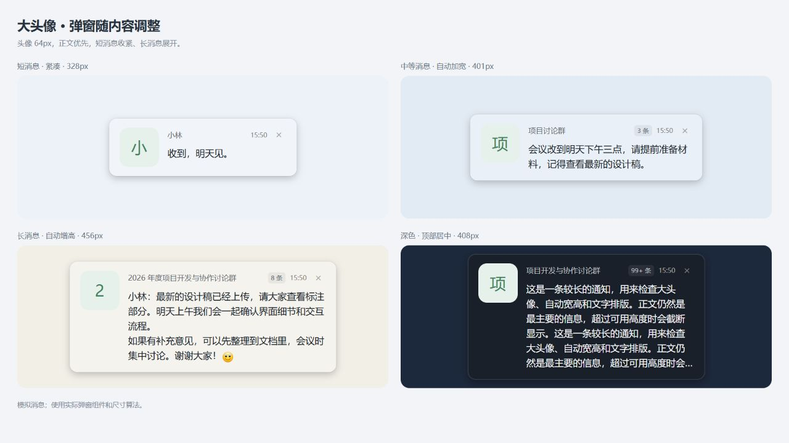
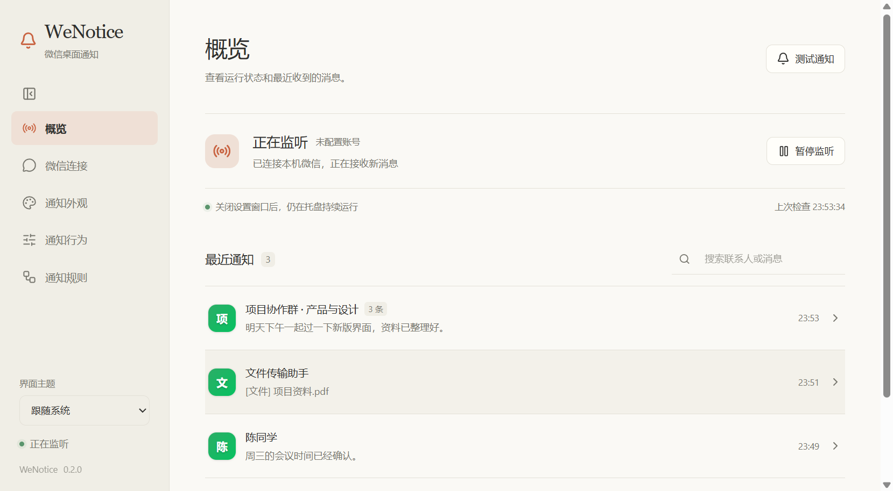
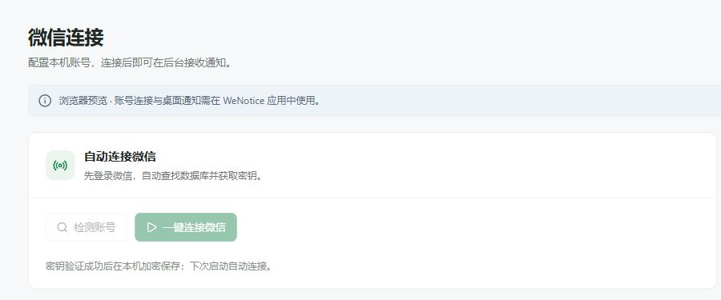
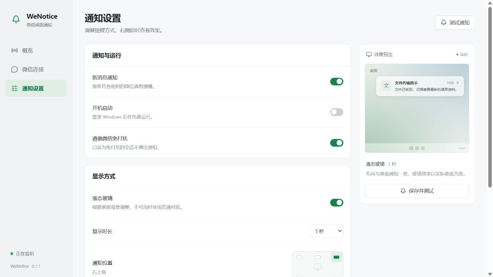
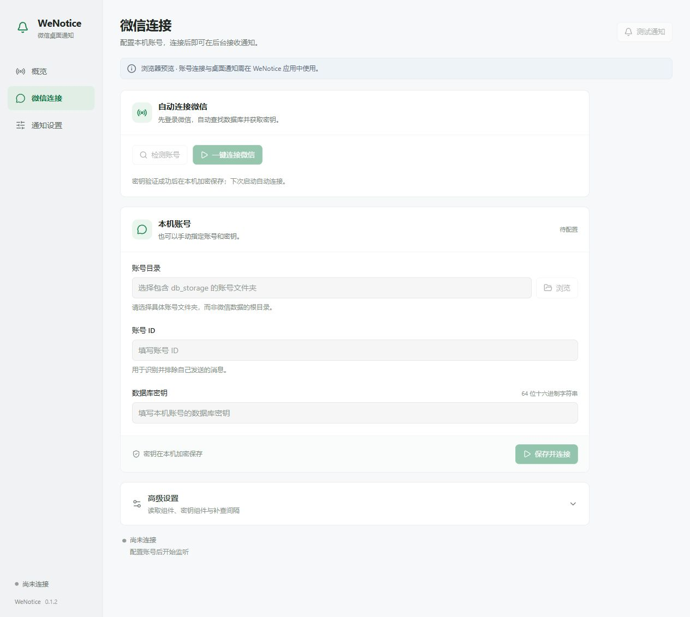
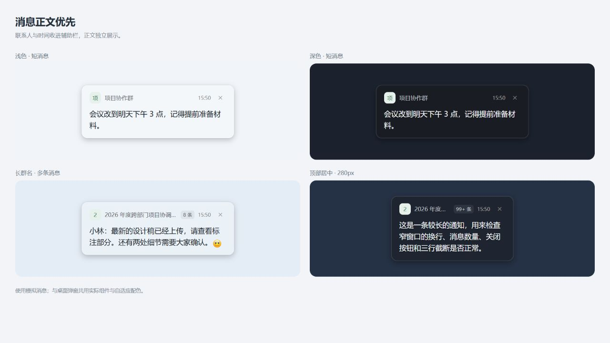

# WeNotice

<p align="center">
  <strong>专为 Windows 打造的轻量、原生质感微信桌面通知应用</strong>
</p>

<p align="center">
  
</p>

---

## 🌟 核心特性

- **0.2.0 自定义与界面重构**：暖白/深色 Claude 风格界面、可折叠导航、通知外观与行为参数、会话和关键词规则、按星期免打扰时段。
- **微信前台自动隐藏通知**：默认开启；继续记录历史，切回微信清除弹窗与待显示消息，切离后不补弹。

本轮独立便携测试包：`releases/WeNotice-0.2.0-customization/win-unpacked/WeNotice.exe`。先从托盘退出旧版再启动；原有发布包保留。配置方法、迁移备份及验证范围见 [源码说明](source/README.md#自定义设置)。



- **一键自动连接**：自动检测本机微信账号数据目录，支持多账号选择与密钥自动校验，配置通过系统 `safeStorage` 安全加密保存。
- **独立后台读取**：基于独立后台进程与命名管道/定时扫描监控新消息，不注入、不写入微信数据库，安全稳定。
- **精准消息过滤**：自动过滤自己发送的消息、应用启动前的历史消息，支持私聊、群聊、免打扰设置以及联系人白名单/黑名单。
- **智能通知合并**：支持同会话连续消息合并，通知窗口尺寸根据文本长短智能自适应，阅读体验极佳。
- **点击直达聊天**：点击通知弹窗一键唤起微信并准确定位至对应好友/群聊会话窗口。
- **现代化视觉质感**：原生毛玻璃（LiquidGlass）背景效果与自适应环境亮度主题，自然融入 Windows 11/10 桌面。
- **便捷系统托盘**：常驻托盘监听、支持开机自启、通知暂停免打扰模式及最近通知历史。

---

## 📸 界面预览

| 设置与账号连接 | 通知偏好与黑白名单 |
| :---: | :---: |
|  |  |

| 自动检测与验证 | 通知气泡样式 |
| :---: | :---: |
|  |  |

---

## 📁 目录结构

```text
WeNotice/
├── source/                  # 项目完整源码工程（Electron + React + TypeScript + Vite）
│   ├── electron/            # Electron 主进程、后台读取组件与核心逻辑
│   ├── src/                 # React 前端界面（通知弹窗、设置页、毛玻璃效果）
│   ├── resources/           # 本机微信底层适配 DLL 与辅助工具
│   ├── tests/               # 自动化单元测试
│   └── package.json
├── 启动WeNotice.cmd          # 快速启动已构建应用的批处理脚本
├── 打包WeNotice.cmd          # 快速执行构建打包的批处理脚本
├── .gitignore               # Git 忽略配置（已排除本地构建产物与归档）
└── README.md                # 项目主文档
```

> **说明**：打包生成的二进制安装包和免安装程序输出至 `releases/` 目录（已在 `.gitignore` 中排除，建议通过 [GitHub Releases](https://github.com/devhunk/WeNotice/releases) 页面发布）。

---

## 🚀 快速上手与日常使用

### 日常运行与打包（本地）

- **启动程序**：双击根目录下的 `启动WeNotice.cmd`（需先完成一次构建）。
- **执行打包**：先从右下角托盘完全退出 WeNotice，再双击根目录下的 `打包WeNotice.cmd`。

---

## 🛠 开发与构建指南

### 环境准备

- **操作系统**：Windows 10 / 11 (x64)
- **Node.js**：>= 20.x
- **微信桌面端**：已安装并登录

### 开发步骤

进入 `source` 目录执行命令：

```powershell
cd source

# 1. 安装项目依赖
npm install

# 2. 启动开发模式（支持热重载）
npm run dev

# 3. 运行自动化测试
npm test

# 4. 构建生产代码并打包为免安装便携版
npm run dist:portable

# 5. 构建生成 Windows NSIS 安装包 (.exe)
npm run dist:win
```

构建生成的安装包与 `win-unpacked` 便携目录将统一输出至项目根目录下的 `releases/`。

---

## 🤖 CI/CD 自动化构建与发布

项目配置了完整的 GitHub Actions 工作流（[`.github/workflows/build-and-release.yml`](.github/workflows/build-and-release.yml)）：

### 1. 提交自动测试与编译（CI）
- **触发条件**：每次向仓库推送代码（`push`）或发起拉取请求（`pull_request`）时自动触发。
- **执行内容**：自动在 Windows Server 虚拟环境中拉取依赖、运行自动化单元测试，并完成 TypeScript 类型检查与全量构建验证，保障每一次提交的稳定性。

### 2. 按需打包与发布 Release（CD）
支持两种发布触发方式：

- **方式一：GitHub 页面一键手动触发（推荐）**
  1. 进入 GitHub 仓库页面，点击 **Actions** 标签。
  2. 在左侧选择 **CI & Release** 工作流，点击右上角 **Run workflow**。
  3. 可按需配置发布选项：
     - `publish_release`：是否正式发布到 GitHub Releases（默认为 `true`；若设为 `false` 则仅打包并保留为 Actions Artifacts 供下载测试）。
     - `tag_name`：指定发布的版本 Tag（如 `v0.1.6`，留空则默认读取 `source/package.json` 中的版本）。
     - `release_title`：自定义 Release 标题（留空默认为 `WeNotice <tag>`）。
     - `draft` / `prerelease`：是否作为草稿或预发布版本。
     - `release_notes`：自定义更新日志说明（留空则自动提取 commits 和 PR 记录）。
  4. 点击 **Run workflow** 按钮启动，CI 测试通过后会自动编译、生成安装包与便携包，并发布至 Releases。

- **方式二：推送 Git Tag 自动发布**
  在本地打好版本 Tag 并推送到 GitHub，即可自动触发完整测试并发布 Release：
  ```powershell
  git tag v0.1.6
  git push origin v0.1.6
  ```

每次发布会自动生成并上传以下产物：
- **Windows NSIS 安装包**：`WeNotice Setup <version>.exe`
- **免安装便携版**：`WeNotice-<tag>-windows-x64-portable.zip`
- **增量更新映射**：`WeNotice Setup <version>.exe.blockmap`
- **SHA256 校验和**：`SHA256SUMS.txt`（包含所有产物的 SHA256 哈希值）

---

## 🔒 隐私与安全性

1. **零写入安全设计**：应用仅以只读方式查询本地微信数据库，绝不修改、删除或篡改任何数据。
2. **密钥本地加密**：数据库访问密钥通过 Electron 原生提供的 Windows DPAPI (`safeStorage`) 加密保存在用户本地的 `%APPDATA%\WeNotice\settings.json`，不会明文暴露。
3. **纯本地离线运行**：所有消息处理与弹窗逻辑均在本地完成，无任何云端上传行为。

---

## 📄 来源与开源协议

- 本项目基于 [hicccc77/WeFlow](https://github.com/hicccc77/WeFlow) 的通知实现与读取接口设计进行了深度重构与优化（重新实现了应用外壳、增量监控、防抖合并队列及安全配置流程）。
- 沿用上游项目的 **CC-BY-NC-SA-4.0** 开源许可证，遵循非商业性使用、署名及相同方式共享原则。
- 详细第三方依赖许可与原生组件说明请参见 [source/THIRD_PARTY_NOTICES.md](source/THIRD_PARTY_NOTICES.md) 与 [source/LICENSE](source/LICENSE)。
